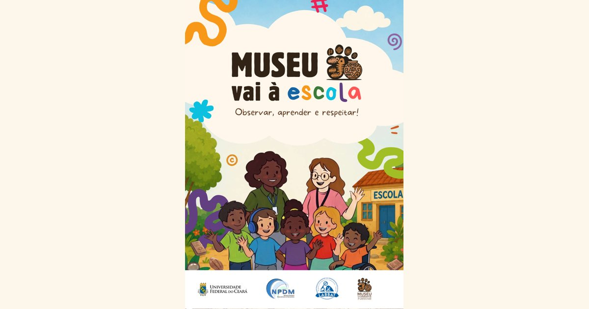

# Museu vai à escola

**Observar, aprender e respeitar!**

Cartilha digital do **MIPA — Museu Itinerante de Paleontologia e Arqueologia**, projeto do Laboratório de Bioarqueologia Translacional (LABBAT) do Núcleo de Pesquisa e Desenvolvimento de Medicamentos (NPDM) da Universidade Federal do Ceará.

### [Ler a cartilha online](https://odimarfalcao.github.io/CartilhaNPDM/)

[](https://odimarfalcao.github.io/CartilhaNPDM/)

[Baixar o PDF (5,5 MB)](cartilha-museu-vai-a-escola.pdf)

---

## Sobre a obra

Esta publicação integra as ações educativas voltadas à democratização do conhecimento e à salvaguarda do patrimônio cultural. Ela foi elaborada para acompanhar a visita do Museu Itinerante de Paleontologia e Arqueologia e busca aproximar os estudantes das histórias preservadas nos fósseis, nos vestígios arqueológicos e nas memórias das comunidades.

Em quadrinhos, a turma da Profa. Adelania recebe o museu na escola e descobre como a ciência investiga o passado, por que o patrimônio arqueológico e paleontológico precisa ser preservado e como respeitar as diferenças. A cartilha articula a educação patrimonial com a **educação antirracista**, as **práticas anticapacitistas** (com rampa de acesso e alfabeto em Libras, por exemplo) e o reconhecimento dos saberes dos povos indígenas e das comunidades.

| Páginas | Conteúdo |
|---|---|
| 1–3 | Capa, ficha técnica e apresentação |
| 4–5 | Conheça a turma |
| 6 | O museu vem aí! |
| 7 | Tem lugar pra todo mundo |
| 8 | Quando nasce um cientista |
| 9 | Comunicar é incluir |
| 10 | Olhar atento, grandes ideias |
| 11 | Muito para contar! |
| 12 | Um objeto, muitas histórias |
| 13–14 | Apoio e realização · A ciência continua por aqui |

Dica: para abrir direto numa página, acrescente `#pagina-N` ao link (ex.: [`…/CartilhaNPDM/#pagina-9`](https://odimarfalcao.github.io/CartilhaNPDM/#pagina-9)).

## Ficha técnica

- **Coordenação editorial:** Manoel Odorico de Moraes Filho
- **Direção de arte, projeto gráfico e diagramação:** Lorena Emanuele Pinheiro Ferreira
- **Acompanhamento técnico:** Allysson Allan de Farias, Pedro Henrique Santos Gaspar Melo, Sebastião Lacerda de Lima Filho
- **Revisão de texto:** Allysson Allan de Farias, Pedro Henrique Santos Gaspar Melo

**Equipe do MIPA:** Manoel Odorico de Moraes Filho, Allysson Allan de Farias, Sebastião Lacerda Lima Filho, Beatriz Freire Guimarães, Pedro Henrique Santos Gaspar Melo, Lucas Ramon Porto de Assis, José Gonçalves de Sousa Júnior, Letícia Evangelista Tomé da Silva, Gabriel Vaz Mesquita dos Santos, Lorena Emanuele Pinheiro Ferreira, Odimar Sousa Falcão Filho, José Márcio Rocha Venâncio, Mariana Lima Veríssimo, Davi de Sousa Vieira, Marcos Wendel da Silva Barros, Luiz Anderson da Silva Alves.

**Apoio e realização:** Universidade Federal do Ceará · NPDM · LABBAT · MIPA · Ministério da Educação · FNDCT · Ministério da Ciência, Tecnologia e Inovação · Pop Ciência · CNPq.

**Contato:** [@mipa.npdm.ufc](https://www.instagram.com/mipa.npdm.ufc/) · [mipa@ufc.br](mailto:mipa@ufc.br)

---

## Sobre este repositório

O site é estático (HTML, CSS e JavaScript, sem build) e é publicado pelo **GitHub Pages** a partir da branch `main`.

```
├── index.html                       página do leitor
├── css/estilo.css                   visual (cores tiradas da cartilha)
├── js/leitor.js                     liga o efeito de virar página aos botões
├── vendor/page-flip.browser.js      biblioteca StPageFlip (MIT)
├── paginas/pagina-01…14.webp        cada página da cartilha como imagem
├── cartilha-museu-vai-a-escola.pdf  PDF para download
├── img/compartilhar.jpg             prévia ao compartilhar o link
└── ferramentas/                     scripts para atualizar os arquivos
```

### Como atualizar a cartilha

1. Exporte do Canva como **PDF para impressão**, com "Comprimir arquivo" **desmarcado**. Depois reduza o tamanho (o [iLovePDF](https://www.ilovepdf.com/pt/comprimir_pdf) funciona bem) e salve como `cartilha-museu-vai-a-escola.pdf`.
2. Regenere as imagens das páginas:
   ```bash
   pip install pymupdf pillow
   python ferramentas/gerar_paginas.py cartilha-museu-vai-a-escola.pdf paginas
   ```
3. Se o número de páginas mudar, ajuste a lista de `<div class="pagina">` no `index.html`.
4. Faça o commit e o push. O site se atualiza em 1–2 minutos.

> O GitHub recusa arquivos com mais de 100 MB. Se o PDF exportado do Canva vier maior que isso, o script `ferramentas/comprimir.py` (pikepdf) recomprime as imagens sem perder o texto.

### Testar localmente

```bash
python -m http.server 8000
# abra http://localhost:8000
```

## Créditos e direitos

O conteúdo da cartilha (textos e ilustrações) pertence aos seus autores e ao MIPA/LABBAT/NPDM/UFC. Para reutilizá-lo, entre em contato pelo [mipa@ufc.br](mailto:mipa@ufc.br).

O efeito de folhear é feito com o [StPageFlip](https://github.com/Nodlik/StPageFlip), de Nodlik, sob licença MIT (veja `vendor/LICENSE-page-flip.txt`).
